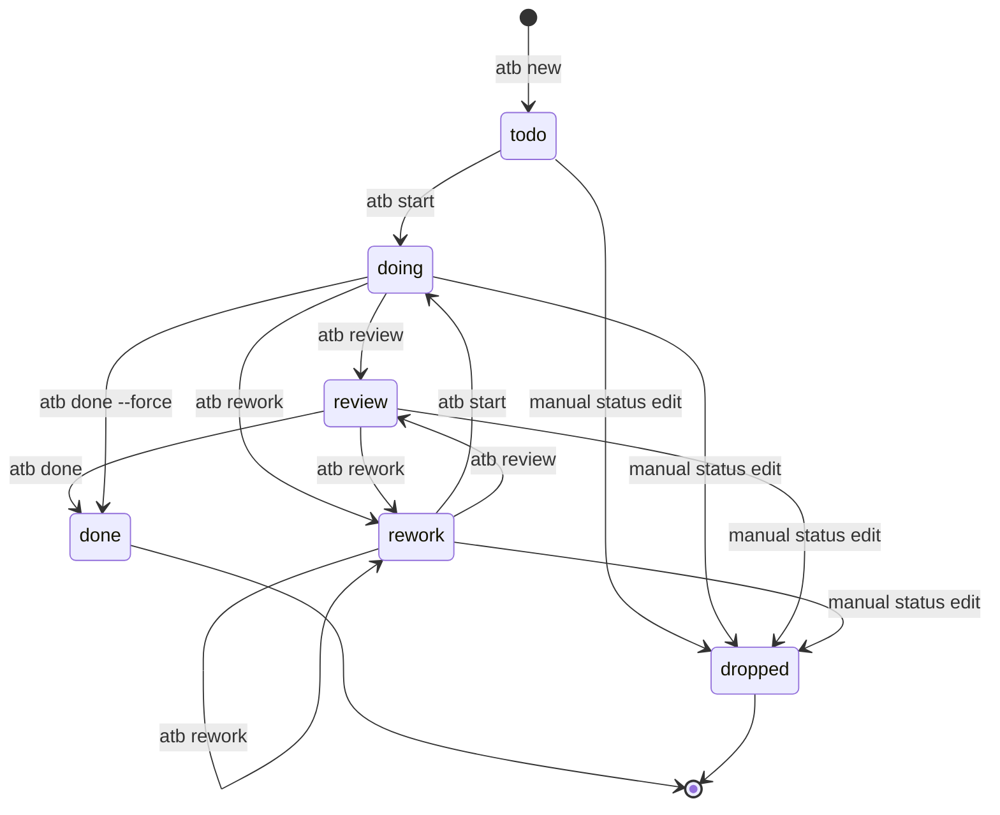

# Multi-agent workflow guide

`atb` (agent-taskboard) is built for one coordinator session managing several AI coding agents in parallel. This guide walks through a coordinator's real day from task creation to post-merge cleanup and history audit.

See also [README.md](../README.md) for installation, [guide.zh-CN.md](guide.zh-CN.md) for Chinese, [DESIGN.md](../DESIGN.md) for the data model, and [walkthrough.sh](../examples/walkthrough.sh) for an executable demo.

## Roles

| Role | Responsibilities |
|---|---|
| Coordinator (main session) | Writes and scopes task sheets, runs `atb start`, forwards `atb prompt` / `atb dispatch`, watches progress, reviews, requests rework, merges, cleans up with `atb gc`, and commits task-sheet state changes. |
| Agent window | Works inside the absolute worktree path from the handoff, obeys `allow` / `deny`, runs the configured tests, commits on its task branch, and reports changed files, test results, branch name, and problems. Never pushes or merges. |

---

## A coordinator's day, step by step

All example outputs below were captured by running the commands in a temporary repository (`demo-repo`, via `examples/walkthrough.sh` and a temporary watch/review verification script).

### 1. Write task sheets (`atb new`)

```bash
atb new "Update greeting message" --agent claude --allow "src/app.py" --allow "tests/**" --deny "src/core.py"
atb new "Localize greeting" --agent opencode --allow "src/app.py" --allow "tests/**" --deny "src/core.py"
```

Real output:

```text
/tmp/.../demo-repo/.taskboard/tasks/T001.md
/tmp/.../demo-repo/.taskboard/tasks/T002.md
```

`--allow` and `--deny` are repeatable globs (`deny` always wins over `allow`; an empty `allow` list imposes no allow restriction, though `deny` still applies). Fill in the `## 验收` / acceptance checkboxes in `.taskboard/tasks/TNNN.md` before starting.

### 2. Start isolated worktrees (`atb start`)

```bash
atb start T001
atb start T002
```

Real output:

```text
started T001: branch=claude/update-greeting-message
worktree: /tmp/.../demo-repo-tasks/T001
base: 59af091421ef5cc50735a097e5453aa2dc994d25
status -> doing
task sheet updated (/tmp/.../demo-repo/.taskboard/tasks/T001.md); commit it yourself (not auto-committed)
started T002: branch=opencode/localize-greeting
worktree: /tmp/.../demo-repo-tasks/T002
base: 59af091421ef5cc50735a097e5453aa2dc994d25
status -> doing
task sheet updated (/tmp/.../demo-repo/.taskboard/tasks/T002.md); commit it yourself (not auto-committed)
```

`start` only accepts `todo` or `rework`. It validates `depends`, records the baseline commit, creates `worktree_root/<ID>`, and flips the sheet status to `doing` (`rework` reuses the existing worktree and branch). Commit `.taskboard/tasks/` changes on the main branch when convenient so `atb log` records status timestamps cleanly.

### 3. Generate and forward handoffs (`atb prompt` / `atb dispatch`)

```bash
atb prompt T001 --lang en
atb dispatch
```

Real `atb dispatch` output:

```markdown
## 项目：demo-repo

### claude

| ID | 标题 | Agent | 状态 | 发这句话 |
|---|---|---|---|---|
| T001 | Update greeting message | claude | doing | 请在 /tmp/.../demo-repo 运行 PYTHONPATH=src python3 -m agent_taskboard prompt T001，按交接文本执行。全程中文，完成后不要 push、不要合并。 |

### opencode

| ID | 标题 | Agent | 状态 | 发这句话 |
|---|---|---|---|---|
| T002 | Localize greeting | opencode | doing | 请在 /tmp/.../demo-repo 运行 PYTHONPATH=src python3 -m agent_taskboard prompt T002，按交接文本执行。全程中文，完成后不要 push、不要合并。 |
```

`atb prompt` includes the absolute worktree path, branch, `allow`/`deny` scope, “do not push / do not merge” rules, test command, report format, and task body (hoisting `## 返工` / rework notes to the very top when present). `atb dispatch --lang zh|en` builds a per-window forwarding table for active tasks.

### 4. Watch progress (`atb watch`, `atb status`, `atb board`)

While agent windows are working, run the recommended coordinator watcher so you catch both newly started edits and quiet stalls:

```bash
atb watch --stall 30 --activity --timeout 3600
```

Real outputs captured in a temporary repository when uncommitted edits start (`--activity`) and when an active task goes silent past the threshold (`--stall`):

```text
T001 未提交改动 0 → 2
T001 已 45m 无活动（阈值 30 分钟，未提交 2 个文件）
```

- `--activity` fires when uncommitted file counts change so you know an agent started editing.
- `--stall 30` fires as soon as a `doing`/`rework` task reaches 30 minutes without a new commit or recent uncommitted-file mtime (tasks already past the threshold at start time are reported immediately, once per run).
- `atb watch` exits 0 on change/alert and 3 on timeout (`--timeout 3600`).

For an instant snapshot across all tasks or an HTML overview:

```bash
atb status
atb board --html board.html --lang en --stall 120
```

Real `atb status` output (with the `READY` column showing merge readiness and any leading blocker):

```text
main: no upstream
ID    STATUS  AGENT     TITLE              BRANCH                      AHEAD/BEHIND  FILES  DIRTY  VIOL  IDLE  TEST  READY
T001  review  claude    Update greeting    claude/update-greeting      +1/-0         1      0      1     1s    —     ✗ scope_violation
T002  review  opencode  Localize greeting  opencode/localize-greeting  +1/-0         1      0      0     0s    ✓     ✓
todo: 0  doing: 0  review: 2  rework: 0  done: 0  dropped: 0
```

- `READY` is computed for `review` tasks (including `merge-tree` conflict checks against `target` and active-task conflicts): `✓` when merge-ready, `✗ <code>` showing the first blocker otherwise. Non-`review` tasks (`todo`, `doing`, `rework`, `done`, `dropped`) show `—` (`ready: null`).
- In `atb board --html`, the `Ready` / `可合并` column uses the same logic and shows the full `blockers` list on hover in the selected `--lang`.
- `atb status --json` adds `ready` (`true` / `false` / `null`) and `blockers` to each item under `tasks` without changing top-level keys (`tasks`, `summary`).

### 5. Agent reports back: check scope and tests (`atb check` & `atb conflicts`)

```bash
atb check T001
atb check T002 --test
atb conflicts
```

Real outputs:

```text
# atb check T001 (scope violation, exit 1)
ahead: 1
behind: 0
changed files: 2
denied:
  - src/core.py
outside:
  (none)
uncommitted:
  (none)

# atb check T002 --test (exit 0)
ahead: 1
behind: 0
changed files: 2
denied:
  (none)
outside:
  (none)
uncommitted:
  (none)
test: exit 0 in 0.061s

# atb conflicts (exit 1 on real merge conflict)
真实冲突:
  T001 <-> T002: src/app.py
同文件但能自动合并:
  (none)
基线漂移:
  (none)
无法判断:
  (none)
```

Add `--isolate-home` to `atb check --test` to run tests with a throwaway `HOME` and detect files written to `$HOME`.

### 6. Review and read the "Activity and history" section (`atb review`)

```bash
atb review T001 --lang en
```

Real output (with 2 uncommitted files left in the worktree and a recorded test run):

```markdown
# Review: T001 Update greeting

> **Warning: 2 uncommitted file(s) remain in the worktree; this review covers committed changes only.**

- ID: T001
- Agent: claude
- Status: review
- Branch: claude/update-greeting
- Base: 60be446044211c788c7a098343f5049e27f834f4

## Check results

- Violations (denied): 0
- Violations (outside): 1
- Uncommitted changes: 2

## Last test run

- ✓ passed

## Activity and history

- DIRTY (uncommitted count): 2
- IDLE: 0s
- Rework count: 0
- Last test detail: 2026-11-18 13:39, exit 0 (0.1s)
- Status history:
  - 2026-11-18 13:39  ddf865c  todo -> doing
  - 2026-11-18 13:39  uncommitted  doing -> review
- Doctor issues: none
```

How to read the enriched review sheet:
- **Top uncommitted warning**: appears whenever `uncommitted > 0`, reminding you that `diffstat` and branch commits do not yet include those files in the worktree.
- **`DIRTY` & `IDLE`**: live uncommitted count and time since last commit/uncommitted edit, matching `atb status`.
- **`Rework count`**: how many rework notes have been appended so far (`## 返工`).
- **`Last test detail`**: exact timestamp, exit code, and duration from `.taskboard/runs/<ID>.jsonl`.
- **`Status history`**: up to the latest 10 status transitions recorded for this sheet.
- **`Doctor issues`**: any `doctor` `FAIL` specifically affecting this task (for example, a missing worktree or mismatched worktree branch), without dumping unrelated repo checks.

#### Structured review output (`atb review ID --json`)

Use `--json` when scripts or orchestrators need to decide programmatically whether a task is ready to merge (pass `--out FILE` to save to disk, and `--lang zh|en` to localize `blockers[*].message` while keeping keys fixed; JSON is serialized with `sort_keys=True`). Like the Markdown form, `atb review --json` transitions `doing`/`rework` to `review`.

- **Top-level fields**: `id`, `title`, `agent`, `status`, `branch`, `base`, `scope` (`denied`, `outside`, `uncommitted`), `test` (`result`, `last_run`), `activity` (`dirty`, `idle_seconds`, `rework_count`, `status_history`), `doctor_fails`, `diffstat` (`files` list + `totals`), `conflicts`, `mergeable`, `drift`, `acceptance` (`[{"text", "checked"}]`), `ready` (boolean), `blockers` (`[{"code", "message"}]`).
- **Blocker codes**:

| Code | Meaning |
|---|---|
| `missing_branch` | Task branch or worktree is missing or unreadable |
| `scope_violation` | Committed or uncommitted changes hit `denied` or `outside` paths |
| `uncommitted` | Worktree still has uncommitted changes |
| `test_not_passed` | Latest test record is missing or non-zero exit |
| `merge_conflict` | Conflicts with `target` (`merge-tree`) or active tasks (or target ref unreadable) |
| `doctor_fail` | Task-specific `doctor` `FAIL` (e.g. missing worktree or wrong branch) |

Example — filter merge-ready tasks with `jq`:

```bash
# Quick scan across status --json
atb status --json | jq -r '.tasks[] | select(.ready == true) | .id'

# Or confirm a single task via review --json (note: flips doing/rework -> review)
atb review T002 --json | jq -r 'select(.ready) | .id'
```

### 7. Request rework or finish & merge (`atb rework` / `atb done`)

```bash
# Needs fixes
atb rework T001 --note "Revert changes to src/core.py and resolve conflict in src/app.py."

# Ready to merge
atb done T002 --merge
# Or merge, clean up worktree/branch, and push target branch
atb done T002 --merge --clean --push
```

Real output:

```text
rework T001: note appended
merged 'opencode/localize-greeting' into main with --no-ff
marked T002 done; task sheet updated — commit it yourself (never pushed)
```

`atb done` refuses if there are scope violations, uncommitted files, or no passing last test record. Pass `--clean` together with `--merge` to remove the worktree and branch immediately on merge. Pass `--push` (only valid with `--merge`) to push `target` to upstream/`origin` after merging; you can also set `push_after_done = true` in `.taskboard/config.toml` to push after `--merge` by default, and override it per command with `--no-push`. Pushes never use `--force`; if a push is rejected, the local merge is preserved and `atb` tells you how to rebase and push manually.

### 8. Clean up leftover worktrees and branches (`atb gc`)

Tasks merged without `--clean`, merged manually, or marked `dropped` leave worktrees and local branches behind. `atb gc` inspects `done` and `dropped` tasks only (`todo` / `doing` / `review` / `rework` are never touched).

```bash
atb gc            # dry-run preview first (default)
atb gc --apply    # remove eligible clean & merged items
```

Real output:

```text
T002 [done] -> remove: ready to remove worktree and branch (worktree=/tmp/.../demo-repo-tasks/T002, branch=opencode/localize-greeting)
dry-run only; re-run with --apply to remove eligible items

T002 [done] removed worktree and branch (worktree=/tmp/.../demo-repo-tasks/T002, branch=opencode/localize-greeting)
removed 1, skipped 0, failed 0
```

- **Dry-run by default**: `atb gc` only prints planned actions (`remove`, `skip: dirty`, `skip: unmerged`, `skip: missing`).
- **Never force-deletes branches**: `atb gc --apply` calls `git worktree remove` (refuses dirty worktrees) and `git branch -d` (never `-D`). For `dropped` tasks with unmerged commits, `--include-unmerged` still keeps the branch and only removes a clean worktree so unmerged work cannot be lost silently.

### 9. One-shot environment health check (`atb doctor`)

```bash
atb doctor
```

Real output (before running `atb gc --apply` in the walkthrough):

```text
OK    git: git 2.54 (>= 2.38)
OK    config: config loaded (target=main, worktree_root=/tmp/.../demo-repo-tasks)
OK    sheets: 2 task sheet(s) valid
OK    active: all 1 active task(s) healthy
WARN  leftovers: 1 done/dropped task(s) still have worktree or branch: T002 (hint: run: atb gc)
OK    orphans: no orphan worktrees under /tmp/.../demo-repo-tasks
```

`atb doctor` is strictly read-only and checks six areas: git ≥ 2.38, config & writability, task-sheet parsing/dependencies, active worktrees/branches, `done`/`dropped` leftovers (reusing `gc`), and orphan worktrees. It exits 1 when any check is `FAIL`, and 0 otherwise.

### 10. Trace chronological task history (`atb log`)

Even after `atb gc --apply` has deleted the task branch and worktree, `atb log` reconstructs the full timeline:

```bash
atb log T002
```

Real output:

```text
T002 Localize greeting [done]
2026-11-18 13:29  4e2baf9  todo → doing
2026-11-18 13:29  测试 exit 0（0.1s）
2026-11-18 13:29  2192ef1  doing → review
2026-11-18 13:29  e7d5acc  review → done
2026-11-18 13:29  已合并（621ccb1）
返工记录：0 条
```

Pass `--verbose` to also print the last 5 lines of each recorded test run output, or `--json` for structured history events.

---

## State machine

This is the behavior in the current `main` implementation (`cmd_start`, `cmd_review`, `cmd_rework`, `cmd_done`; statuses in `sheet.py`, active statuses in `checks.py`):



Notes:

- `atb check` and `atb prompt` do not change status.
- `atb review` changes `doing` or `rework` to `review`.
- `dropped` is a valid sheet status (`status = "dropped"` edited manually when a task is abandoned).
- `done --merge` and `done --clean` require: main worktree, target branch checked out, no overlapping uncommitted files, and a passing last test record.

## Command cheat sheet

| Command | Use |
|---|---|
| `atb init` | Create `.taskboard/` and default config. |
| `atb new "title" --agent X [--allow G]... [--deny G]... [--depends ID]... [--body @FILE\|-] [--copy-to DIR]` | Create a task sheet in `todo`; `--body` writes the Markdown body from a UTF-8 file or stdin, `--copy-to DIR` also copies the sheet to `DIR/ATB_TASK_<ID>.md`. |
| `atb edit ID [--body @FILE\|-] [--title T] [--agent A] [--add-allow G] [--remove-allow G] [--add-deny G] [--remove-deny G] [--copy-to DIR]` | Edit a sheet without hand-editing TOML (repeatable add/remove options). |
| `atb list [--status S]` / `atb show ID` | Inspect sheets. |
| `atb start ID [--base REV] [--force]` | Open/reuse the worktree and set `doing`. |
| `atb prompt ID [--lang zh\|en]` | Print the complete handoff (with a "run atb sync first" line when the branch is behind). |
| `atb dispatch [--json] [--lang zh\|en]` | Print a per-window forwarding checklist. |
| `atb watch [--interval S] [--timeout S] [--stall MIN] [--activity] [--json]` | Block until status/commits/new-task changes, stalls, or activity changes. |
| `atb check ID [--test] [--strict] [--isolate-home] [--json]` | Scope check; optionally run tests (isolated `HOME` option). |
| `atb status [--json]` | Board metrics, `DIRTY`, `IDLE`, last test, `READY` (`ready`/`blockers`), upstream state, and a `sync` suggestion for the first three tasks behind target. |
| `atb conflicts [--json]` | File overlap, merge-tree conflicts, and drift. |
| `atb review ID [--out FILE] [--lang zh\|en] [--json]` | Build an enriched review sheet or structured JSON (`ready`/`blockers`); flips `doing`/`rework` to `review`. |
| `atb rework ID --note TEXT` (or `@file`) | Send back and append rework notes. |
| `atb done ID [--merge] [--clean] [--force] [--push \| --no-push]` | Verify and finish; `--merge` refuses not-ready tasks (same blockers as `review --json`) unless `--force` or `require_ready_for_done = false`; optional cleanup and non-forced push. |
| `atb sync ID [--rebase \| --merge] [--dry-run]` | Bring the target up to date inside the task worktree (default `--rebase`; refuses dirty worktrees, aborts conflicts back to the original state, predicts them with `--dry-run`). |
| `atb stats [--since YYYY-MM-DD] [--agent NAME] [--json] [--lang zh\|en]` | Per-agent throughput, rework rate, cycle times and test health. |
| `atb sessions [--since SPEC] [--adapter NAME] [--redact] [--json] [--lang zh\|en]` | Read-only view of local Claude Code / Codex / Gemini CLI / OpenCode sessions, mapped to tasks. |
| `atb gc [ID...] [--apply] [--include-unmerged] [--json]` | Preview or safely clean up leftover worktrees and branches for `done`/`dropped` tasks. |
| `atb doctor [--json]` | One-shot read-only environment and board health check (one line per session adapter). |
| `atb log ID [--json] [--verbose]` | Chronological status changes, rework notes, test runs, and merges. |
| `atb board --html FILE [--stall MINUTES] [--lang zh\|en]` | Export a standalone static HTML board (default `zh`, stall threshold `120` min). |
| `atb serve [--port 8766] [--host 127.0.0.1] [--poll SECONDS] [--read-only]` | Serve the local read-only console and JSON API v1 (stdlib only, no CDN). |

All commands accept `--help`.

## Sheet bodies, readiness, statistics, sync, sessions and serve

- **Bodies without hand-editing.** `atb new "Fix login" --agent opencode
  --body @task.md` (or `--body -` for stdin) writes the Markdown body in one
  step; bodies are normalized to one blank line after the closing `+++` and a
  single trailing newline. `atb edit T001 --body @new.md --add-allow
  "tests/**" --remove-deny "docs/**" --title "New title"` edits metadata and
  scope without touching the TOML by hand; `done`/`dropped` tasks are
  refused. `--copy-to DIR` (on `new` and `edit`) writes an extra copy to
  `DIR/ATB_TASK_<ID>.md` for editors that only open one directory; the
  directory must already exist.
- **`done --merge` is gated.** It refuses tasks with blockers, using exactly
  the same evaluation as `review --json` (scope violations, uncommitted
  changes, failing or missing tests, merge conflicts, doctor failures). If
  the sheet has no test command and no test record, the refusal explains how
  to configure one. `--force` merges anyway and lists what it ignored (it
  still allows finishing a `doing` task, as before); set
  `require_ready_for_done = false` in `config.toml` to warn instead of
  refusing.
- **`atb stats`** answers "who should get the next task": per agent it shows
  done/dropped/active counts, the share of tasks with at least one rework,
  the start→done cycle median/P90, the review-wait median, and the failure
  rate of the last recorded test run. Tasks without committed history are
  excluded from the cycle metrics and counted in a footer note.
- **`atb sync T001`** updates a task branch inside its worktree: rebase onto
  the target by default (`--merge` for a merge commit), refusal on uncommitted
  changes, automatic `--abort` back to the original state on conflict with
  the conflicted files listed, and `--dry-run` to predict the outcome with
  `git merge-tree`. When the branch is on a remote the output reminds the
  agent to `git push --force-with-lease` themselves — atb never pushes it.
- **`atb sessions`** observes every installed agent read-only (Claude Code,
  Codex, Gemini CLI, OpenCode; other tools via the
  `agent_taskboard.adapters` entry point). Sessions map to tasks by working
  directory or branch; the rest are free sessions. Big JSONL stores are read
  head+tail only; OpenCode's SQLite database is opened `mode=ro` so a running
  OpenCode is never disturbed. `--redact` hides message summaries entirely.
- **`atb serve`** serves the local console (<http://127.0.0.1:8766>): summary
  strip, per-agent swimlanes for today, task detail with evidence chips, and
  live updates over SSE — pure standard-library Python with vanilla JS/CSS,
  fully offline. See `docs/api.md` for the JSON API v1 contract.
