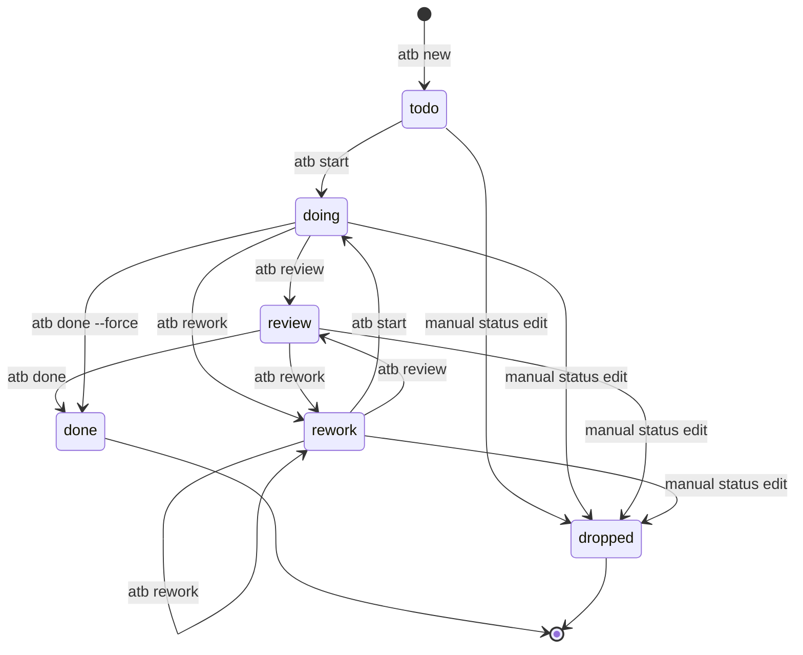

# Multi-agent workflow guide

`atb` (agent-taskboard) is built for one main session coordinating several AI coding agents in parallel. This guide describes the workflow that the repository itself uses: the main session writes task sheets, opens isolated worktrees, reviews changes, and merges; agent windows work only inside the handoff text they receive.

See also the [README](../README.md) for installation and the [design notes](../DESIGN.md) for the data model.

## Roles

| Role | Responsibilities |
|---|---|
| Main session | Writes and scopes task sheets, runs `atb start`, forwards `atb prompt` to an agent, reviews, requests rework, merges, and commits the task-sheet status changes. |
| Agent window | Works in the absolute worktree path from the handoff, respects `allow` / `deny`, runs the configured tests, and reports changed files, test results, branch name, and problems. It never pushes or merges. |

A task sheet is the contract. The main session should put the goal, the allowed and denied paths, the acceptance checklist, and any dependency in the sheet before starting work.

## One task, end to end

### 1. Create the task

```bash
atb new "Add a quota command" \
  --agent opencode \
  --allow "src/pkg/quota.py" \
  --allow "tests/test_quota.py" \
  --deny "src/pkg/readers.py" \
  --deny "CHANGELOG.md"
```

`--allow` and `--deny` are repeatable globs. Deny wins over allow. An empty allow list means “no allow restriction”, but deny still applies. Fill in the acceptance section of the generated `.taskboard/tasks/TNNN.md` before starting.

### 2. Start the worktree

```bash
atb start T012
```

`start` accepts only `todo` or `rework`. It checks `depends`, records the baseline commit, creates `worktree_root/<ID>` on the task branch, and changes the sheet to `doing`. For `rework`, it reuses the existing worktree and branch. `--base REV` chooses an explicit baseline; `--force` skips an unmet dependency check but prints a warning. A `todo` task with an existing branch or worktree path is rejected.

### 3. Generate and forward the handoff

```bash
atb prompt T012 --lang zh
```

Give the complete output to the agent. It contains the absolute worktree path, branch, allow/deny lists, “do not push / do not merge” rules, the test command, the reporting format, and the task body. If the sheet has a rework section, it appears first. `--json` returns `text`, `worktree`, and `branch` for scripting.

### 4. Agent work

The agent edits only allowed paths, commits on its task branch, and runs the task test command. It must not push, merge, rewrite history, or touch the main worktree.

### 5. Check the result

```bash
atb check T012 --test
```

`check` compares the committed diff (`base...branch`) plus uncommitted files in the worktree against `allow` / `deny`. It reports ahead/behind counts, changed files, denied and outside paths, and uncommitted files. Scope violations exit 1. Uncommitted changes are only a warning by default; `--strict` also exits 1. `--test` runs the task's test command in the worktree, appends the result to `.taskboard/runs/T012.jsonl`, and exits 1 on failure.

### 6. Review

```bash
atb review T012 --out review-T012.md --lang zh
```

The review sheet combines scope checks, the last test run, diffstat, conflicts/drift, and the acceptance checklist. `review` changes `doing` to `review`; it does not change a `rework` sheet. If the review is not acceptable, use `rework`; if it is acceptable, use `done`.

### 7. Rework or finish

```bash
# Not acceptable
atb rework T012 --note "Fix the cache path before retrying"
atb start T012          # rework -> doing, reuses the worktree
# agent appends commits, then:
atb check T012 --test
atb review T012

# Acceptable
atb done T012 --merge --clean
```

`rework` accepts `doing`, `review`, or `rework` and appends a timestamped note to the sheet's rework section. `--note @file` reads a longer review from a file. Because `review` in 0.1.0 only flips `doing`, a rework task must go through `atb start` before `review` and `done`.

`done` accepts `review`; `--force` also accepts `doing`, but it never skips scope, uncommitted-file, or last-test blockers. Without `--merge`, it only marks the task done. `--merge` must run from the main worktree on the configured target branch, uses `git merge --no-ff`, and aborts on conflicts. `--clean` is valid only with `--merge` and removes the worktree and branch with safe removal (`git branch -d`, never `-D`). Nothing is ever pushed.

## State machine

This is the behavior in the current `main` implementation (`cmd_start`, `cmd_review`, `cmd_rework`, `cmd_done`; statuses in `sheet.py`, active statuses in `checks.py`):



Notes:

- `atb check` and `atb prompt` do not change status.
- `atb review` on a `rework` sheet produces a review but leaves the status unchanged; run `atb start` first.
- `dropped` is a valid sheet status, but 0.1.0 has no `atb drop` command. Set `status = "dropped"` in the sheet manually if a task is abandoned.
- `done --merge` and `done --clean` have additional preconditions: main worktree, target branch checked out, no conflicting uncommitted files, and a passing last test record.

## Parallel tasks

Use `allow` / `deny` to make ownership explicit before starting:

```bash
atb new "Reader tests" --agent claude \
  --allow "src/pkg/readers.py" --allow "tests/test_readers.py" \
  --deny "src/pkg/dashboard/**"

atb new "Dashboard shell" --agent gemini \
  --allow "src/pkg/dashboard/**" --allow "tests/test_dashboard.py" \
  --deny "src/pkg/readers.py"
```

Then check for collisions before work overlaps:

```bash
atb status
atb conflicts
```

`status` shows status, branch, ahead/behind counts, changed files, violations, and the last test result. `conflicts` compares active tasks (`doing`, `review`, `rework`) by changed files, then uses `git merge-tree` to distinguish real conflicts from clean auto-merges. It also reports baseline drift: files changed on the target after a task's baseline that the task also touches. Use the output to reorder tasks, adjust scopes, or rebase a task before review. `conflicts` exits 1 for real conflicts and 2 when it cannot determine an answer (for example, a missing branch).

## Real pitfalls

### T003: merge-tree messages looked like files

**Symptom:** a real conflict was reported as `['f.txt', 'Auto-merging f.txt', 'CONFLICT ...']`, and invalid refs were treated as “clean auto-merge”.

**Cause:** `git merge-tree` writes human-readable messages as well as the tree OID and file list; the parser also assumed every non-zero exit meant a conflict.

**How atb prevents it:** `gitops.merge_tree_conflicts` uses `--no-messages`, validates the first line as a tree OID, and returns only file paths. `checks.compute_conflicts` puts unreadable pairs into an explicit `errors` section and exits 2 instead of silently continuing. The T003 rework note records the exact expected conflict list (`['f.txt']`) so this cannot regress quietly.

### T006: offline packaging needed a newer setuptools

**Symptom:** `pip install -e .` and `python -m build --no-isolation` failed locally with `invalid command 'bdist_wheel'` or “wheel is not installed”.

**Cause:** the build requirements declared `wheel` separately while the machine had setuptools 65.5; the environment was offline and could not fetch it.

**How atb prevents it:** the build requirement is now `setuptools>=70.1`, which provides `bdist_wheel`; the task sheet and README state that online installation may fetch build dependencies, while offline use runs from `PYTHONPATH=src`. A test asserts that `wheel` is absent from `build-system.requires` and the setuptools minimum is at least 70.1.

### T002: start and prompt had edge cases

**Symptom:** a `todo` task could be started twice, a `rework` task needed a different worktree path, and the handoff did not consistently put rework notes first.

**Cause:** the first implementation treated `todo` and `rework` the same and rendered the body before considering the rework section.

**How atb prevents it:** `cmd_start` accepts only `todo`/`rework`; `todo` refuses an existing branch or path, while `rework` reuses the worktree. `cmd_prompt` extracts the rework section and places it first with a visible marker. The T002 acceptance tests cover dependency refusal, `--force`, duplicate start, worktree reuse, and rework-first prompt output.

### T004 and T003: two agents, overlapping commands

**Symptom:** T003 was changing `src/**` and tests while T004 needed README, CI, and examples; both could have touched shared command documentation and delayed each other.

**Cause:** task scopes were described only in prose, so an agent could not prove its edit was outside another task's ownership.

**How atb prevents it:** T004's sheet denies `src/**` and `tests/**` while allowing docs/CI/examples; `atb conflicts` compares the active branches and reports overlapping files or baseline drift before merge. The T004 sheet also records that it merges only after T003, making the dependency explicit instead of relying on chat memory.

## Command cheat sheet

| Command | Use |
|---|---|
| `atb init` | Create `.taskboard/` and default config. |
| `atb new "title" --agent X [--allow G]... [--deny G]... [--depends ID]...` | Create a task sheet in `todo`. |
| `atb list [--status S]` / `atb show ID` | Inspect sheets. |
| `atb start ID [--base REV] [--force]` | Open/reuse the worktree and set `doing`. |
| `atb prompt ID [--lang zh\|en]` | Print the complete handoff. |
| `atb check ID [--test] [--strict] [--json]` | Scope check; optionally run tests. |
| `atb status [--json]` | Board metrics and last test state. |
| `atb conflicts [--json]` | File overlap, merge-tree conflicts, and drift. |
| `atb review ID [--out FILE] [--lang zh\|en]` | Build a review sheet; `doing` becomes `review`. |
| `atb rework ID --note TEXT` (or `@file`) | Send back and append rework notes. |
| `atb done ID [--merge] [--clean] [--force]` | Verify and finish; optional merge and cleanup. |
| `atb gc [ID...] [--apply] [--include-unmerged] [--json]` | Preview or clean up leftover worktrees and branches for `done`/`dropped` tasks. |
| `atb board --html FILE` | Export a standalone static board. |

All commands accept `--help`; the flags above are the current 0.1.0 surface.

## Cleanup (`atb gc`)

Tasks merged without `--clean`, merged manually, or marked `dropped` leave worktrees and local branches behind. `atb gc` inspects `done` and `dropped` tasks only (`todo` / `doing` / `review` / `rework` are never touched) and classifies each candidate as `remove`, `skip: dirty`, `skip: unmerged`, or `skip: missing`.

- **Dry-run by default:** `atb gc` only prints what would happen without deleting anything. Pass `--apply` to execute removals.
- **Never force-deletes branches:** `atb gc --apply` uses `git worktree remove` (refuses when dirty) and `git branch -d` (never `-D`). For `dropped` tasks with unmerged commits, `--include-unmerged` still keeps the branch and only removes a clean worktree so unmerged work is never lost silently.
