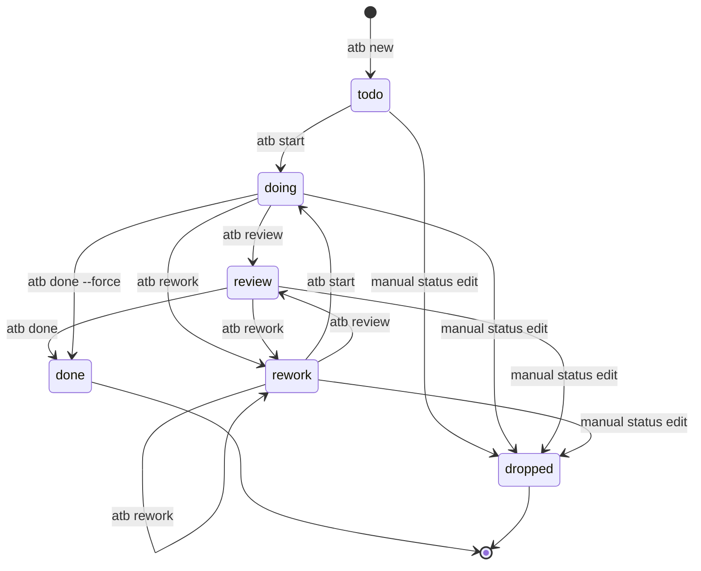

# 多 Agent 协作指南

`atb`（agent-taskboard）面向“一个主会话协调多个 AI 编程 Agent 并行干活”的场景。本文按协调者一天的真实流程，串联从建单、盯进度、审查到清理与追溯的完整操作。

安装见 [README.zh-CN.md](../README.zh-CN.md)，英文版见 [guide.md](guide.md)，数据模型见 [DESIGN.md](../DESIGN.md)，可直接运行的演示脚本见 [walkthrough.sh](../examples/walkthrough.sh)。

## 角色

| 角色 | 职责 |
|---|---|
| 协调者（主会话） | 写任务单、划定范围、运行 `atb start`、转发 `atb prompt` / `atb dispatch`、盯进度、审查、打回、合并、用 `atb gc` 清理，并提交任务单状态变更。 |
| Agent 窗口 | 在交接文本给出的绝对 worktree 路径里工作，遵守 `allow` / `deny`，运行配置好的测试，在任务分支提交，并回报改动文件、测试结果、分支名和问题。不 push，不合并。 |

---

## 协调者一天的完整流程

下面每一段示例输出，均来自临时仓库 `demo-repo` 中实际运行 `examples/walkthrough.sh` 与临时 watch/review 脚本得到的真实终端输出。

### 1. 写任务单（`atb new`）

```bash
atb new "Update greeting message" --agent claude --allow "src/app.py" --allow "tests/**" --deny "src/core.py"
atb new "Localize greeting" --agent opencode --allow "src/app.py" --allow "tests/**" --deny "src/core.py"
```

真实输出：

```text
/tmp/.../demo-repo/.taskboard/tasks/T001.md
/tmp/.../demo-repo/.taskboard/tasks/T002.md
```

`--allow` 和 `--deny` 均可重复传入通配符（`deny` 永远优先于 `allow`；`allow` 为空表示不限允许范围，但 `deny` 仍生效）。开工前把 `.taskboard/tasks/TNNN.md` 里的 `## 验收` 清单补充完整。

### 2. 开工建 worktree（`atb start`）

```bash
atb start T001
atb start T002
```

真实输出：

```text
started T001: branch=claude/update-greeting-message
worktree: /tmp/.../demo-repo-tasks/T001
base: 59af091421ef5cc50735a097e5453aa2dc994d25
status -> doing
task sheet updated (/tmp/.../demo-repo/.taskboard/tasks/T001.md); commit it yourself (not auto-committed)
started T002: branch=opencode/localize-greeting
worktree: /tmp/.../demo-repo-tasks/T002
base: 59af091421ef5cc50735a097e5453aa2dc994d25
status -> doing
task sheet updated (/tmp/.../demo-repo/.taskboard/tasks/T002.md); commit it yourself (not auto-committed)
```

`start` 只接受 `todo` 或 `rework`。它会校验 `depends`、记录基线提交、创建 `worktree_root/<ID>` 并把状态改成 `doing`（`rework` 复用已有 worktree 与分支）。适时把 `.taskboard/tasks/` 的变更提交到主分支，这样 `atb log` 能精确记录每次状态变化时间。

### 3. 生成并转发交接文本（`atb prompt` / `atb dispatch`）

```bash
atb prompt T001 --lang zh
atb dispatch
```

`atb dispatch` 真实输出：

```markdown
## 项目：demo-repo

### claude

| ID | 标题 | Agent | 状态 | 发这句话 |
|---|---|---|---|---|
| T001 | Update greeting message | claude | doing | 请在 /tmp/.../demo-repo 运行 PYTHONPATH=src python3 -m agent_taskboard prompt T001，按交接文本执行。全程中文，完成后不要 push、不要合并。 |

### opencode

| ID | 标题 | Agent | 状态 | 发这句话 |
|---|---|---|---|---|
| T002 | Localize greeting | opencode | doing | 请在 /tmp/.../demo-repo 运行 PYTHONPATH=src python3 -m agent_taskboard prompt T002，按交接文本执行。全程中文，完成后不要 push、不要合并。 |
```

`atb prompt` 会生成含绝对 worktree 路径、分支、`allow`/`deny` 范围、“不要 push / 不要合并”规则、测试命令、回报格式与任务单正文的完整交接文本（有 `## 返工` 小节时会自动置顶）。`atb dispatch --lang zh|en` 按窗口生成活跃任务转发清单。

### 4. 盯进度（`atb watch`、`atb status`、`atb board`）

窗口干活期间，推荐在主会话终端运行 `atb watch`，既能抓到 Agent 刚开始改文件，也能第一时间抓住悄悄停住的窗口：

```bash
atb watch --stall 30 --activity --timeout 3600
```

在临时仓库中真实触发 `--activity`（未提交改动变化）和 `--stall`（无活动超阈值）时的输出：

```text
T001 未提交改动 0 → 2
T001 已 45m 无活动（阈值 30 分钟，未提交 2 个文件）
```

- `--activity`：工作区未提交文件数变化时立即报出，代表 Agent 已经开工。
- `--stall 30`：`doing`/`rework` 任务连续 30 分钟无新提交且无新文件 mtime 时报出（启动时已超阈值的任务会立刻报出，同一次运行内每个任务只报一次）。
- `atb watch` 发生变动或告警时返回退出码 0，超时（`--timeout 3600`）返回 3。

随时用 `atb status` 或导出静态看板看全局进展：

```bash
atb status
atb board --html board.html --lang zh --stall 120
```

`atb status` 真实输出（`READY` 列直接显示能否合并及首个阻断代码）：

```text
main: no upstream
ID    STATUS  AGENT     TITLE              BRANCH                      AHEAD/BEHIND  FILES  DIRTY  VIOL  IDLE  TEST  READY
T001  review  claude    Update greeting    claude/update-greeting      +1/-0         1      0      1     1s    —     ✗ scope_violation
T002  review  opencode  Localize greeting  opencode/localize-greeting  +1/-0         1      0      0     0s    ✓     ✓
todo: 0  doing: 0  review: 2  rework: 0  done: 0  dropped: 0
```

- `READY` 列仅针对 `review` 状态任务计算（含对目标分支的 `merge-tree` 冲突检测及与其他活跃任务的冲突检测）：可合并显示 `✓`，否则显示 `✗ <第一个 blocker 代码>`；其余状态（`todo`、`doing`、`rework`、`done`、`dropped`）一律显示 `—`（`ready` 为 `null`）。
- 在 `atb board --html` 中，`可合并` / `Ready` 列复用同一套判断，鼠标悬停可查看完整 `blockers` 列表（语言随 `--lang` 切换）。
- `atb status --json` 会在 `tasks` 的每一行增加 `ready`（`true` / `false` / `null`）和 `blockers` 字段，顶层键（`tasks`、`summary`）保持不变。

### 5. 窗口回报后检查范围与冲突（`atb check` 与 `atb conflicts`）

```bash
atb check T001
atb check T002 --test
atb conflicts
```

真实输出：

```text
# atb check T001（越界，退出码 1）
ahead: 1
behind: 0
changed files: 2
denied:
  - src/core.py
outside:
  (none)
uncommitted:
  (none)

# atb check T002 --test（通过，退出码 0）
ahead: 1
behind: 0
changed files: 2
denied:
  (none)
outside:
  (none)
uncommitted:
  (none)
test: exit 0 in 0.061s

# atb conflicts（存在真实冲突，退出码 1）
真实冲突:
  T001 <-> T002: src/app.py
同文件但能自动合并:
  (none)
基线漂移:
  (none)
无法判断:
  (none)
```

给 `atb check --test` 加上 `--isolate-home` 可以用一次性的临时 `HOME` 跑测试，避免污染本机配置，并标记测试向 `$HOME` 写入的文件。

### 6. 审查并解读“活动与历史”段（`atb review`）

```bash
atb review T001 --lang zh
```

真实输出（当 worktree 里还有 2 个未提交文件、且存在一次测试记录时）：

```markdown
# 审查：T001 Update greeting

> **注意：worktree 里还有 2 个未提交文件，审查的是已提交部分。**

- ID: T001
- Agent: claude
- 状态: review
- 分支: claude/update-greeting
- 基线: 60be446044211c788c7a098343f5049e27f834f4

## 检查结果

- 越界 (denied): 0
- 越界 (outside): 1
- 未提交改动: 2

## 最近一次测试

- ✓ 通过

## 活动与历史

- DIRTY（未提交数）: 2
- IDLE（无活动时长）: 0s
- 返工次数: 0
- 最近测试详情: 2026-11-18 13:39，exit 0（0.1s）
- 状态变化时间线:
  - 2026-11-18 13:39  ddf865c  todo → doing
  - 2026-11-18 13:39  uncommitted  doing → review
- doctor 异常: 无
```

如何解读新增内容：
- **顶部未提交提示**：只要工作区有未提交文件就会在最上方出现，提醒你下面 `diffstat` 审查的是已提交部分，未提交改动需让 Agent 提交或确认丢弃。
- **`DIRTY` 与 `IDLE`**：与 `atb status` 一致，反映当前未提交文件数与距离上次活动的时间。
- **`返工次数`**：任务单 `## 返工` 中累计被打回的次数。
- **`最近测试详情`**：直接读取 `.taskboard/runs/<ID>.jsonl` 的本地时间、退出码与耗时。
- **`状态变化时间线`**：列出最多最近 10 条状态变迁，便于判断任务卡了多久或流转了几轮。
- **`doctor 异常`**：只列出与当前任务直接相关的 `FAIL`（如该任务 worktree 缺失或所在分支不对），不会塞入无关的全局检查。

#### 结构化审查输出（`atb review ID --json`）

脚本或协调工具需要程序化判断“能否合并”时，可加 `--json`（可与 `--out FILE` 同用，并与 `--lang zh|en` 联动切换 `blockers[*].message` 语言，JSON 键名固定且使用 `sort_keys=True` 输出）。与 Markdown 版一样，`atb review --json` 会把 `doing`/`rework` 改为 `review`。

- **字段说明**：`id`、`title`、`agent`、`status`、`branch`、`base`、`scope`（`denied`、`outside`、`uncommitted`）、`test`（`result` + `last_run`）、`activity`（`dirty`、`idle_seconds`、`rework_count`、`status_history`）、`doctor_fails`、`diffstat`（`files` 列表 + `totals` 合计）、`conflicts`、`mergeable`、`drift`、`acceptance`（`[{"text", "checked"}]`）、`ready`（布尔值）、`blockers`（`[{"code", "message"}]`）。
- **Blocker 代码表**：

| 代码 | 含义 |
|---|---|
| `missing_branch` | 任务分支或 worktree 缺失或无法读取 |
| `scope_violation` | 已提交或未提交改动命中 `denied` 或超出 `allow` 范围 |
| `uncommitted` | worktree 仍有未提交改动 |
| `test_not_passed` | 最近一次测试未通过或无测试记录 |
| `merge_conflict` | 与目标分支（`merge-tree`）或活跃任务存在冲突（或目标引用不可读） |
| `doctor_fail` | 与本任务相关的 `doctor` `FAIL`（如 worktree 缺失或分支不一致） |

用 `jq` 筛出可合并任务的示例：

```bash
# 从 status --json 快速筛选已就绪任务
atb status --json | jq -r '.tasks[] | select(.ready == true) | .id'

# 或针对单个任务执行 review --json 判断（注意会把 doing/rework 转为 review）
atb review T002 --json | jq -r 'select(.ready) | .id'
```

### 7. 打回返工或确认合并（`atb rework` / `atb done`）

```bash
# 不合格，打回返工
atb rework T001 --note "Revert changes to src/core.py and resolve conflict in src/app.py."

# 合格，合入目标分支
atb done T002 --merge
# 或合并、清理 worktree/分支并推送目标分支
atb done T002 --merge --clean --push
```

真实输出：

```text
rework T001: note appended
merged 'opencode/localize-greeting' into main with --no-ff
marked T002 done; task sheet updated — commit it yourself (never pushed)
```

`atb done` 会校验越界、未提交改动与最近测试是否通过，缺一不可。`--clean` 与 `--merge` 一起用可在合并后立即安全清理 worktree 与分支。加 `--push`（需与 `--merge` 同用）会在合并后推送 `target` 到上游/`origin`；也可在 `.taskboard/config.toml` 设置 `push_after_done = true` 让 `--merge` 默认推送，并用 `--no-push` 单次覆盖关闭。推送绝不用 `--force`；若远端拒绝推送，本地合并会保留，并提示如何手动 rebase 后推送。

### 8. 清理遗留 worktree 与分支（`atb gc`）

合并时没加 `--clean`、手动合并或改成 `dropped` 的任务会残留 worktree 与本地分支。`atb gc` 只检查 `done` 和 `dropped` 任务（绝不碰 `todo` / `doing` / `review` / `rework`）。

```bash
atb gc            # 默认只预览（dry-run）
atb gc --apply    # 真正执行安全清理
```

真实输出：

```text
T002 [done] -> remove: ready to remove worktree and branch (worktree=/tmp/.../demo-repo-tasks/T002, branch=opencode/localize-greeting)
dry-run only; re-run with --apply to remove eligible items

T002 [done] removed worktree and branch (worktree=/tmp/.../demo-repo-tasks/T002, branch=opencode/localize-greeting)
removed 1, skipped 0, failed 0
```

- **默认只预览**：不加 `--apply` 绝不删文件或分支，每个候选都会给出 `remove`、`skip: dirty`、`skip: unmerged` 或 `skip: missing`。
- **永不强删分支**：`atb gc --apply` 只用 `git worktree remove`（有未提交改动就拒绝）和 `git branch -d`（绝不用 `-D`）。`dropped` 任务若有未合并提交，即使加 `--include-unmerged` 也只删除干净的 worktree，分支继续保留由人工确认。

### 9. 一次性只读环境体检（`atb doctor`）

```bash
atb doctor
```

真实输出（在 walkthrough 执行 `atb gc --apply` 之前运行）：

```text
OK    git: git 2.54 (>= 2.38)
OK    config: config loaded (target=main, worktree_root=/tmp/.../demo-repo-tasks)
OK    sheets: 2 task sheet(s) valid
OK    active: all 1 active task(s) healthy
WARN  leftovers: 1 done/dropped task(s) still have worktree or branch: T002 (hint: run: atb gc)
OK    orphans: no orphan worktrees under /tmp/.../demo-repo-tasks
```

`atb doctor` 完全只读，逐项检查 git ≥ 2.38、配置与父目录可写性、任务单解析与依赖、活跃任务 worktree/分支一致性、`done`/`dropped` 残留（复用 `gc`）以及孤儿 worktree。存在 `FAIL` 时退出码 1，否则 0。

### 10. 按时间线追溯任务历史（`atb log`）

即使 `atb gc --apply` 已经把任务分支和 worktree 删干净，`atb log` 依然能还原全过程：

```bash
atb log T002
```

真实输出：

```text
T002 Localize greeting [done]
2026-11-18 13:29  4e2baf9  todo → doing
2026-11-18 13:29  测试 exit 0（0.1s）
2026-11-18 13:29  2192ef1  doing → review
2026-11-18 13:29  e7d5acc  review → done
2026-11-18 13:29  已合并（621ccb1）
返工记录：0 条
```

加 `--verbose` 可附带每次测试输出的最后 5 行，加 `--json` 可输出结构化事件列表。

---

## 状态机

以下是当前 `main` 的实际流转行为（`cmd_start`、`cmd_review`、`cmd_rework`、`cmd_done`；状态定义见 `sheet.py`，活跃状态见 `checks.py`）：



说明：

- `atb check` 和 `atb prompt` 不改变任务单状态。
- `atb review` 会把 `doing` 或 `rework` 改为 `review`。
- `dropped` 是合法状态（放弃任务时可手动把任务单改成 `status = "dropped"`）。
- `done --merge` / `done --clean` 额外要求：主 worktree、当前处于目标分支、没有会被覆盖的未提交文件，且最近一次测试通过。

## 命令速查

| 命令 | 用途 |
|---|---|
| `atb init` | 创建 `.taskboard/` 和默认配置。 |
| `atb new "标题" --agent X [--allow G]... [--deny G]... [--depends ID]... [--body @FILE\|-] [--copy-to DIR]` | 创建 `todo` 任务单；`--body` 从 UTF-8 文件或 stdin 写入正文，`--copy-to DIR` 额外复制到 `DIR/ATB_TASK_<ID>.md`。 |
| `atb edit ID [--body @FILE\|-] [--title T] [--agent A] [--add-allow G] [--remove-allow G] [--add-deny G] [--remove-deny G] [--copy-to DIR]` | 不用手改 TOML 直接编辑任务单（增删选项可重复）。 |
| `atb list [--status S]` / `atb show ID` | 查看任务单。 |
| `atb start ID [--base REV] [--force]` | 创建/复用 worktree，状态改为 `doing`。 |
| `atb prompt ID [--lang zh\|en]` | 输出完整交接文本（分支落后目标时加"开工前先运行 atb sync ID"）。 |
| `atb dispatch [--json] [--lang zh\|en]` | 按窗口生成活跃任务转发清单。 |
| `atb watch [--interval S] [--timeout S] [--stall MIN] [--activity] [--json]` | 阻塞等待状态/提交/新增任务变化，或 stall/activity 告警。 |
| `atb check ID [--test] [--strict] [--isolate-home] [--json]` | 范围检查；可选在隔离的临时 `HOME` 运行测试。 |
| `atb status [--json]` | 看板指标、`DIRTY`、`IDLE`、最近测试、`READY`（`ready`/`blockers`）、上游未推送状态；对落后目标的前三个任务给出 `atb sync` 建议。 |
| `atb conflicts [--json]` | 文件重叠、merge-tree 冲突和基线漂移。 |
| `atb review ID [--out FILE] [--lang zh\|en] [--json]` | 生成增强审查表或结构化 JSON（含 `ready`/`blockers`）；会把 `doing`/`rework` 变为 `review`。 |
| `atb rework ID --note TEXT`（或 `@file`） | 打回并追加返工记录。 |
| `atb done ID [--merge] [--clean] [--force] [--push \| --no-push]` | 校验并收尾；`--merge` 用与 `review --json` 相同的 blocker 拒绝不 ready 的任务（`--force` 列出并忽略，或配置 `require_ready_for_done = false` 只警告）；可选清理与非强推。 |
| `atb sync ID [--rebase \| --merge] [--dry-run]` | 在任务 worktree 内把目标分支同步进任务分支（默认 `--rebase`；脏 worktree 拒绝、冲突自动 abort 复原、`--dry-run` 用 merge-tree 预测）。 |
| `atb stats [--since YYYY-MM-DD] [--agent NAME] [--json] [--lang zh\|en]` | 按 agent 汇总产出、返工率、周期与测试健康度。 |
| `atb sessions [--since SPEC] [--adapter NAME] [--redact] [--json] [--lang zh\|en]` | 只读观察本机 Claude Code / Codex / Gemini CLI / OpenCode 会话并对应到任务。 |
| `atb gc [ID...] [--apply] [--include-unmerged] [--json]` | 预览或安全清理 `done`/`dropped` 任务遗留的 worktree 和分支。 |
| `atb doctor [--json]` | 一次性只读环境体检（每个会话 adapter 一行）。 |
| `atb log ID [--json] [--verbose]` | 按时间顺序查看单任务状态变迁、返工、测试和合并记录。 |
| `atb board --html FILE [--stall MINUTES] [--lang zh\|en]` | 导出单文件静态 HTML 看板（默认 `zh`，卡住阈值默认 `120` 分钟）。 |
| `atb serve [--port 8766] [--host 127.0.0.1] [--poll SECONDS] [--read-only] [--observe]` | 启动本地只读控制台和 JSON API v1（只用标准库，无 CDN）；`--observe` 只显示本机 agent 会话，可在任意目录启动。 |

所有命令均支持 `--help`。

## 正文、ready 门禁、统计、同步、会话与控制台

- **不用手改正文。** `atb new "修登录" --agent opencode --body @task.md`
  （或 `--body -` 从 stdin）一步写入 Markdown 正文；写入时会规范化为
  `+++` 后恰好一个空行、文件以单个换行结尾。`atb edit T001 --body
  @new.md --add-allow "tests/**" --remove-deny "docs/**" --title "新标题"`
  不碰 TOML 就能改元数据和范围；`done`/`dropped` 任务拒绝编辑。
  `--copy-to DIR`（`new`/`edit` 都支持）把任务单复制一份到
  `DIR/ATB_TASK_<ID>.md`，方便只能打开一个目录的编辑器；目录必须已存在。
- **`done --merge` 有门禁。** 与 `review --json` 完全同一套判定（越界、
  未提交、测试未过或缺失、合并冲突、doctor FAIL），有 blocker 就逐条
  列出并拒绝；任务单没配 `test` 且从未跑过测试时，提示先
  `atb check ID --test` 或填写 `test` 字段。`--force` 照常合并并打印
  "已忽略的 blocker" 清单（仍保留允许完成 `doing` 任务的原语义）；
  `config.toml` 设 `require_ready_for_done = false` 则只警告不拒绝。
- **`atb stats`** 回答"下一单给谁"：按 agent 显示完成/放弃/进行中、至少
  返工一次的任务占比、start→done 周期中位/P90、等待审查中位、最近一次
  测试失败率。缺历史的任务不计入周期，底部注明个数。
- **`atb sync T001`** 在任务 worktree 内更新任务分支：默认 rebase 到目标
  （`--merge` 改为合并）、有未提交改动时拒绝、冲突时自动 `--abort` 恢复
  原状并列出冲突文件、`--dry-run` 用 `git merge-tree` 预测。分支已在远端
  时只提醒 agent 自己执行 `git push --force-with-lease`，atb 从不推送它。
- **`atb sessions`** 只读观察本机所有已安装的 agent（内置 Claude Code、
  Codex、Gemini CLI、OpenCode，其他工具经 `agent_taskboard.adapters`
  入口点注册）。会话按工作目录或分支对应到任务，其余为自由会话。大的
  JSONL 只读头尾，OpenCode 的 SQLite 以只读模式打开，不影响正在运行的
  OpenCode。`--redact` 完全隐藏消息摘要。
- **`atb serve`** 启动本地控制台（<http://127.0.0.1:8766>）：汇总条、按
  agent 的今日泳道、带证据标签的任务详情，SSE 实时刷新——纯标准库 Python
  加原生 JS/CSS，完全离线。JSON API v1 契约见 `docs/api.md`。
