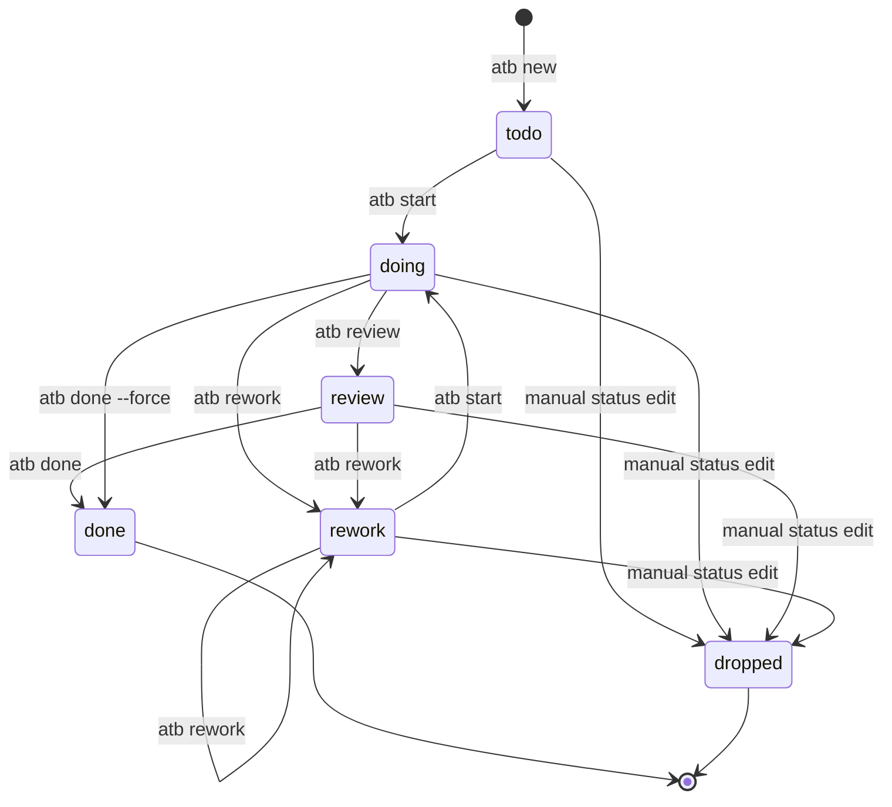

# 多 Agent 协作指南

`atb`（agent-taskboard）面向“一个主会话指挥多个 AI 编程 Agent 并行干活”的场景。本指南描述仓库自己使用的工作流：主会话写任务单、开隔离 worktree、审查和合并；Agent 窗口只按收到的交接文本工作。

安装见 [README](../README.md)，数据模型和设计原则见 [DESIGN.md](../DESIGN.md)。

## 角色

| 角色 | 职责 |
|---|---|
| 主会话 | 写任务单、划定范围、运行 `atb start`、把 `atb prompt` 转发给 Agent、审查、打回、合并，并提交任务单状态变更。 |
| Agent 窗口 | 在交接文本给出的绝对 worktree 路径里工作，遵守 `allow` / `deny`，运行配置的测试，回报改动文件、测试结果、分支名和问题。不 push，不合并。 |

任务单就是双方契约。开工前，主会话应把目标、允许/禁止路径、验收清单和依赖写进任务单。

## 一个任务的完整生命周期

### 1. 新建任务

```bash
atb new "Add a quota command" \
  --agent opencode \
  --allow "src/pkg/quota.py" \
  --allow "tests/test_quota.py" \
  --deny "src/pkg/readers.py" \
  --deny "CHANGELOG.md"
```

`--allow` 和 `--deny` 都可以重复传入通配符。deny 优先于 allow；allow 为空表示不限制允许范围，但 deny 仍然生效。开工前把生成的 `.taskboard/tasks/TNNN.md` 里的验收小节补完整。

### 2. 开工

```bash
atb start T012
```

`start` 只接受 `todo` 或 `rework`。它会检查 `depends`、记录基线提交、在 `worktree_root/<ID>` 创建任务分支的 worktree，并把状态改成 `doing`。`rework` 会复用已有 worktree 和分支。`--base REV` 可显式指定基线；`--force` 跳过未完成的依赖检查，但会输出警告。`todo` 任务若分支或 worktree 路径已存在会被拒绝。

### 3. 生成并转发交接文本

```bash
atb prompt T012 --lang zh
```

把完整输出交给 Agent。内容包括绝对 worktree 路径、分支、allow/deny 列表、“不要 push / 不要合并”规则、测试命令、回报格式和任务单正文。若任务单有返工小节，它会排在最前面。`--json` 会返回 `text`、`worktree`、`branch`，方便脚本使用。

### 4. Agent 干活

Agent 只改允许路径，在任务分支上提交，并运行任务单配置的测试命令。不要 push、不要合并、不要改写历史，也不要碰主 worktree。

### 5. 检查结果

```bash
atb check T012 --test
```

`check` 会把已提交的 diff（`base...branch`）和 worktree 里的未提交文件一起对照 `allow` / `deny`。输出领先/落后提交数、改动文件、denied/outside 路径和未提交文件。越界退出码为 1。未提交改动默认只是警告；`--strict` 时也退出 1。`--test` 会在 worktree 里运行任务测试命令，把结果追加到 `.taskboard/runs/T012.jsonl`，失败时退出 1。

### 6. 审查

```bash
atb review T012 --out review-T012.md --lang zh
```

审查表汇总范围检查、最近一次测试、diffstat、冲突/漂移和验收清单。`review` 会把 `doing` 改成 `review`，但不会改 `rework` 任务单的状态。不合格就 `rework`；合格就 `done`。

### 7. 返工或收尾

```bash
# 不合格
atb rework T012 --note "Fix the cache path before retrying"
atb start T012          # rework -> doing，复用 worktree
# Agent 追加提交后：
atb check T012 --test
atb review T012

# 合格
atb done T012 --merge --clean
```

`rework` 接受 `doing`、`review`、`rework`，并在任务单的返工小节追加带时间戳的记录。`--note @file` 可从文件读取较长审查意见。注意 0.1.0 的 `review` 只会把 `doing` 翻成 `review`，所以返工任务要先 `atb start`，再 `review`，再 `done`。

`done` 接受 `review`；`--force` 也接受 `doing`，但绝不会跳过越界、未提交文件或最近测试不通过的阻断项。不加 `--merge` 只把任务标记为 done。`--merge` 必须在主 worktree、当前分支为配置的 target 时运行，使用 `git merge --no-ff`，冲突时自动 abort。`--clean` 只能和 `--merge` 一起用，并用安全删除（`git branch -d`，绝不用 `-D`）移除 worktree 和分支。任何命令都不会 push。

## 状态机

以下是当前 `main` 的实际行为（`cmd_start`、`cmd_review`、`cmd_rework`、`cmd_done`；状态定义见 `sheet.py`，活跃状态见 `checks.py`）：



说明：

- `atb check` 和 `atb prompt` 不改变状态。
- `atb review` 对 `rework` 任务单会生成审查表，但状态不变；先运行 `atb start`。
- `dropped` 是合法任务单状态，但 0.1.0 没有 `atb drop` 命令；放弃任务时手动把任务单改成 `status = "dropped"`。
- `done --merge` / `done --clean` 还有额外前提：主 worktree、已切到 target 分支、没有会被覆盖的未提交文件，并且最近一次测试记录通过。

## 并行任务

开工前用 `allow` / `deny` 明确文件所有权：

```bash
atb new "Reader tests" --agent claude \
  --allow "src/pkg/readers.py" --allow "tests/test_readers.py" \
  --deny "src/pkg/dashboard/**"

atb new "Dashboard shell" --agent gemini \
  --allow "src/pkg/dashboard/**" --allow "tests/test_dashboard.py" \
  --deny "src/pkg/readers.py"
```

然后提前检查碰撞：

```bash
atb status
atb conflicts
```

`status` 显示状态、分支、领先/落后提交数、改动文件数、越界数和最近测试结果。`conflicts` 对活跃任务（`doing`、`review`、`rework`）比较改动文件，再用 `git merge-tree` 区分真实冲突和可自动合并；同时报告基线漂移：任务开工后 target 又改了、且任务也碰过的文件。根据输出调整任务顺序、范围，或在审查前 rebase。`conflicts` 对真实冲突退出 1，对无法判断（例如分支缺失）退出 2。

## 真实踩过的坑

### T003：merge-tree 的提示行被当成文件名

**现象：** 真实冲突被报成 `['f.txt', 'Auto-merging f.txt', 'CONFLICT ...']`；无效引用反而被当成“能自动合并”。

**原因：** `git merge-tree` 除了树 OID 和文件列表，还会输出人类可读提示；旧解析器也把所有非零退出码都当成冲突。

**atb 怎么防住：** `gitops.merge_tree_conflicts` 使用 `--no-messages`，校验首行是树 OID，只返回文件路径；`checks.compute_conflicts` 把无法判断的任务对放进明确的 `errors` 节并退出 2，不再静默 continue。T003 的返工记录还锁定了期望冲突列表 `['f.txt']`，防止回归。

### T006：离线打包需要更新的 setuptools

**现象：** 本机执行 `pip install -e .` 或 `python -m build --no-isolation` 时报 `invalid command 'bdist_wheel'` 或 “wheel is not installed”。

**原因：** 构建依赖单独声明了 `wheel`，而本机 setuptools 是 65.5；环境离线，无法下载 `wheel`。

**atb 怎么防住：** 构建依赖改为 `setuptools>=70.1`，它自带 `bdist_wheel`；任务单和 README 写清楚联网安装可能获取构建依赖，离线时用 `PYTHONPATH=src` 运行。测试断言 `build-system.requires` 不含 `wheel`，且 setuptools 最低版本不低于 70.1。

### T002：start 与 prompt 的边界情况

**现象：** `todo` 任务可能被重复 start；`rework` 任务需要复用不同路径；交接文本没有稳定地把返工意见放最前。

**原因：** 早期实现把 `todo` 和 `rework` 当成同一种开工，并且先渲染正文再看返工小节。

**atb 怎么防住：** `cmd_start` 只接受 `todo`/`rework`；`todo` 拒绝已存在的分支或路径，`rework` 复用 worktree。`cmd_prompt` 提取返工小节并放到最前面、加醒目标记。T002 的验收测试覆盖依赖拒绝、`--force`、重复 start、worktree 复用和返工优先输出。

### T004 与 T003：两个 Agent，命令文档重叠

**现象：** T003 在改 `src/**` 和测试，T004 需要 README、CI 和示例；两者都可能碰到共享的命令文档，互相拖延。

**原因：** 任务范围只写在文字里，Agent 无法证明自己的改动不在另一个任务的所有权内。

**atb 怎么防住：** T004 的任务单 deny `src/**` 和 `tests/**`，只 allow 文档/CI/示例；`atb conflicts` 在合并前比较活跃分支，报告重叠文件和基线漂移。T004 任务单还明确记录“T003 合并后再合并”，把依赖从聊天记忆变成任务单事实。

## 命令速查

| 命令 | 用途 |
|---|---|
| `atb init` | 创建 `.taskboard/` 和默认配置。 |
| `atb new "标题" --agent X [--allow G]... [--deny G]... [--depends ID]...` | 创建 `todo` 任务单。 |
| `atb list [--status S]` / `atb show ID` | 查看任务单。 |
| `atb start ID [--base REV] [--force]` | 创建/复用 worktree，状态改为 `doing`。 |
| `atb prompt ID [--lang zh\|en]` | 输出完整交接文本。 |
| `atb check ID [--test] [--strict] [--json]` | 范围检查；可选运行测试。 |
| `atb status [--json]` | 看板指标和最近测试状态。 |
| `atb conflicts [--json]` | 文件重叠、merge-tree 冲突和基线漂移。 |
| `atb review ID [--out FILE] [--lang zh\|en]` | 生成审查表；`doing` 变为 `review`。 |
| `atb rework ID --note TEXT`（或 `@file`） | 打回并追加返工记录。 |
| `atb done ID [--merge] [--clean] [--force]` | 校验并收尾；可选合并和清理。 |
| `atb board --html FILE` | 导出单文件静态看板。 |

所有命令都支持 `--help`；上面的参数就是当前 0.1.0 的实际范围。
